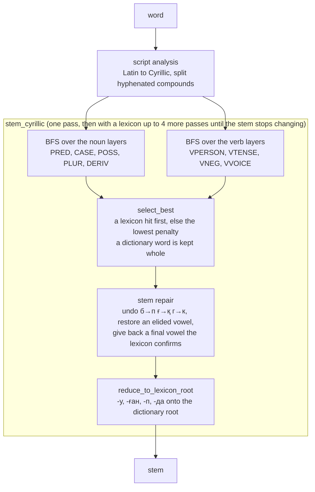
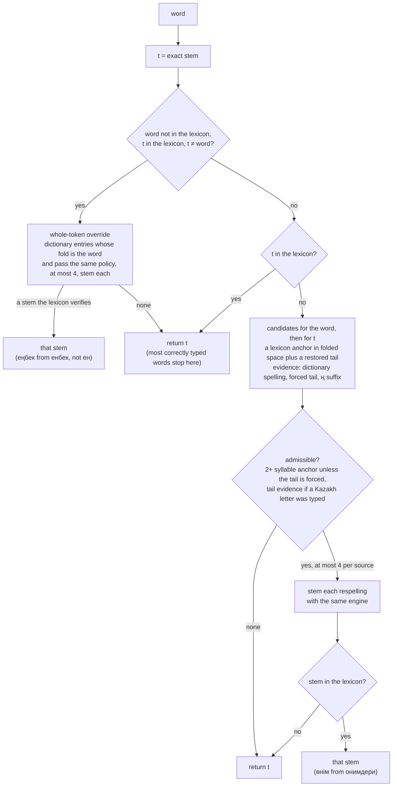
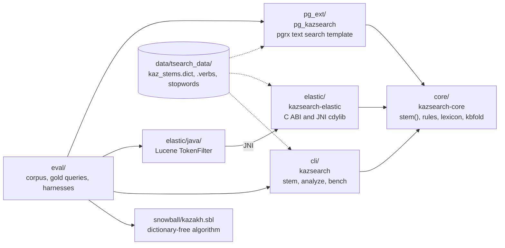
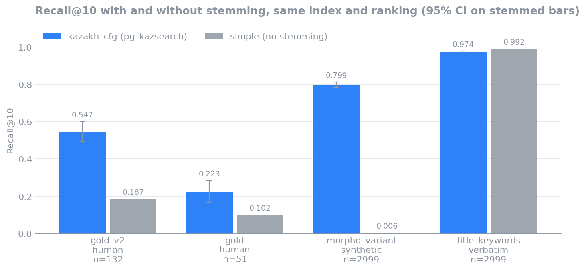
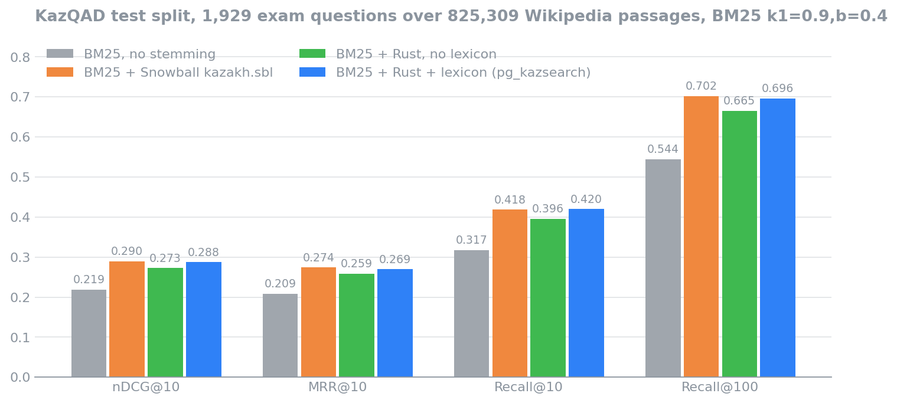
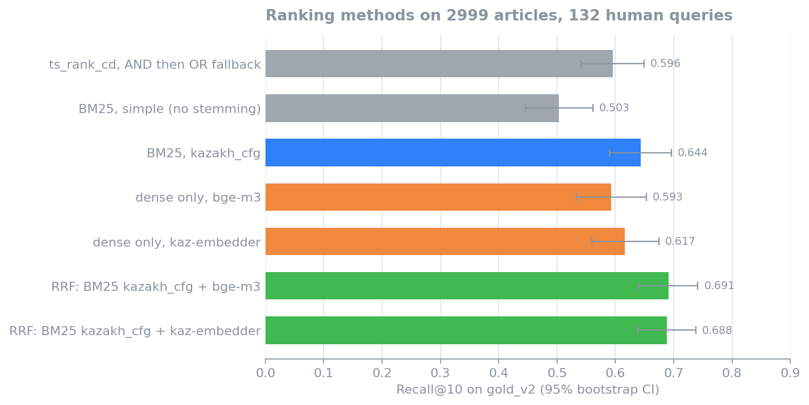
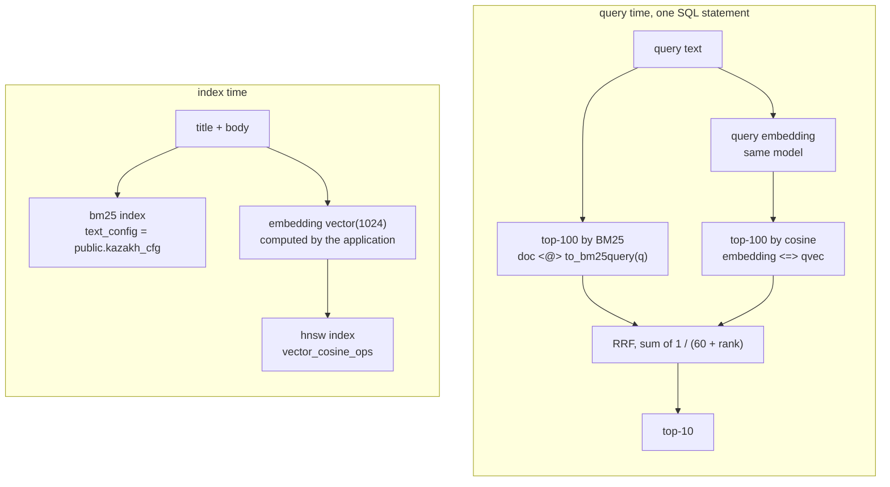
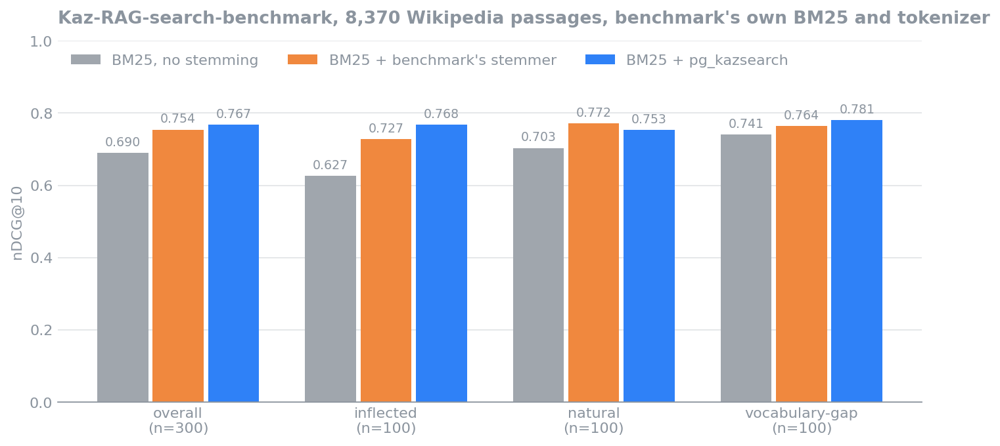
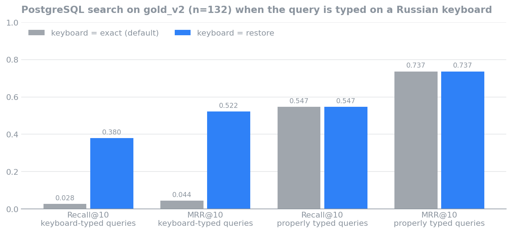
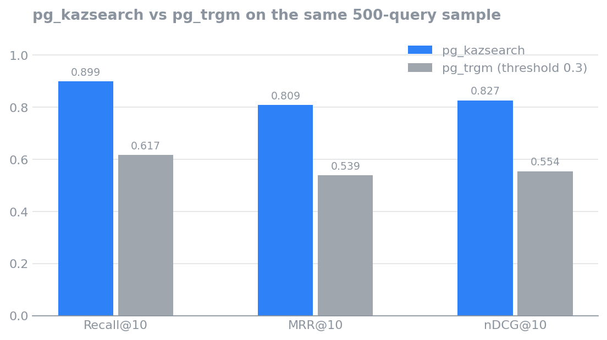

<p align="center">
  <picture>
    <source media="(prefers-color-scheme: dark)" srcset="docs/img/logo-dark.png">
    <source media="(prefers-color-scheme: light)" srcset="docs/img/logo-light.png">
    
  </picture>
</p>

<h1 align="center">pg_kazsearch</h1>

<p align="center">
  Kazakh full-text search for <strong>PostgreSQL</strong> and <strong>Elasticsearch</strong>.<br>
  A Rust stemmer, a Postgres extension, an Elasticsearch plugin, and the benchmarks that justify them.
</p>

<p align="center">
  <a href="LICENSE">LGPL-3.0</a> &nbsp;·&nbsp;
  <a href="https://github.com/darkhanakh/pg-kazsearch/releases">PostgreSQL 16, 17, 18</a> &nbsp;·&nbsp;
  <a href="https://github.com/darkhanakh/pg-kazsearch/releases">Elasticsearch 8.17 to 8.19</a>
</p>

---

Kazakh is agglutinative. One word stacks several suffixes, and each suffix changes shape to match the vowels and the last consonant before it. `мектептерімізде` ("in our schools") is `мектеп` + plural + possessive + locative, and a reader searching for `мектеп` expects to find it. PostgreSQL and Elasticsearch ship no Kazakh stemmer, so without one every inflected form is a different index term and most human queries miss.

pg_kazsearch is that stemmer. On 132 human-written queries over 2,999 news articles, it raises PostgreSQL Recall@10 from 0.187 to 0.547 and MRR@10 from 0.420 to 0.737 against the same index with no stemming (`eval/results/report.json`, measured on `main`). On [KazQAD](https://github.com/IS2AI/KazQAD), an independent benchmark of 1,929 university-entrance exam questions judged against 825,309 Kazakh Wikipedia passages, it raises BM25 nDCG@10 from 0.219 to 0.288 (`eval/results/kazqad.json`).

```sql
CREATE EXTENSION pg_kazsearch;

SELECT to_tsvector('kazakh_cfg', 'президенттің жарлығы');
-- 'жарлық':2 'президент':1

SELECT ts_lexize('pg_kazsearch_dict', 'алмаларымыздағы');
-- {алма}
```

## What is in the repository

- `core/`, the stemmer as a pure Rust library (`kazsearch-core`), with no database dependency.
- `pg_ext/`, the PostgreSQL extension built with [pgrx](https://github.com/pgcentralfoundation/pgrx). It installs a text search template, the `pg_kazsearch_dict` dictionary, a stopword list, and the `kazakh_cfg` configuration.
- `elastic/`, the Elasticsearch analysis plugin. The Java side is a Lucene `TokenFilter` that calls the Rust library over JNI.
- `cli/`, the `kazsearch` command for stemming, tracing a parse, and benchmarking without a database.
- `snowball/kazakh.sbl`, a dictionary-free Kazakh algorithm in the Snowball language, for engines that cannot load a native library.
- `examples/hybrid-search.sql`, BM25 with [pg_textsearch](https://github.com/timescale/pg_textsearch) and dense vectors with [pgvector](https://github.com/pgvector/pgvector) fused in one SQL statement.
- `eval/`, the corpus loader, the human-judged query sets, the KazQAD and Kaz-RAG harnesses, and the scripts that produce every number and chart in this file.

The latest release is [v2.3.0](https://github.com/darkhanakh/pg-kazsearch/releases/tag/v2.3.0) (July 2026). The numbers in this file are measured on `main`, which also carries the stemmer fixes from pull requests #8 and #10 and the `keyboard = restore` option. Those ship with the next release; until then, build from source to get them.

## Quickstart

Start PostgreSQL 18 with the extension preinstalled and stem a sentence:

```bash
docker run -d --name kaz -e POSTGRES_PASSWORD=postgres -p 5432:5432 ghcr.io/darkhanakh/pg-kazsearch:18
sleep 5
docker exec -it kaz psql -U postgres -c "CREATE EXTENSION pg_kazsearch;" \
    -c "SELECT to_tsvector('kazakh_cfg', 'мектептеріміздегі оқушылардың');"
```

You should see `'мектеп':1 'оқушы':2`. Tags `16` and `17` exist for the other supported majors. The images and the `.deb` packages are built for amd64 only, so on Apple Silicon add `--platform linux/amd64` or build from source. For a table, add a generated `tsvector` column and a GIN index:

```sql
ALTER TABLE articles ADD COLUMN fts tsvector
    GENERATED ALWAYS AS (
        setweight(to_tsvector('kazakh_cfg', title), 'A') ||
        setweight(to_tsvector('kazakh_cfg', body), 'B')
    ) STORED;

CREATE INDEX idx_fts ON articles USING GIN (fts);

SELECT title FROM articles
WHERE fts @@ websearch_to_tsquery('kazakh_cfg', 'президенттің жарлығы')
ORDER BY ts_rank_cd(fts, websearch_to_tsquery('kazakh_cfg', 'президенттің жарлығы')) DESC
LIMIT 10;
```

The [Install](#install) section covers the `.deb` packages, the Elasticsearch plugin, and building from source.

## How it works

### One word through the stemmer



The engine (`core/src/explore.rs`) runs a breadth-first search over ordered suffix layers, once with the noun layers and once with the verb layers. Each step strips one suffix from the right and checks two things before it may continue. The suffix must agree in vowel harmony with the last non-glide vowel of the base (у, и, and ю are transparent, so `туризм` accepts either class). The base must satisfy the layer guard, which encodes a morphotactic constraint such as "past `-ты/-ті` attaches only after a voiceless consonant" or "no possessive after a patronymic in `-ұлы/-қызы`". Greedy longest-match stripping fails on Kazakh because a wrong early cut hides the right parse, so the search keeps every surviving path and scores the candidates at the end.

`candidate_penalty` scores a candidate by stem length in syllables, the number of weak and single-letter suffixes, derivational depth, and whether the stem is a lexicon entry. The weights were tuned with CMA-ES against the news corpus. With a lexicon loaded, a candidate whose stem is a dictionary entry is chosen over one that only scores well, and a safety valve keeps a word that is itself a dictionary entry whole when the only parses lose a syllable.

Stem repair reverses the sound changes that attaching a suffix caused. `кітабы` strips to `кітаб`, which `apply_mutation` turns back into `кітап`. `орны` strips to `орн`, and elision restore gives `орын`. When the search cut one vowel too early (`жылына` to `жыл`), `restore_lexicon_vowel` hands the vowel back if the longer form is in the lexicon.

The last stage makes the stemmer idempotent. A single pass is not. One pass takes `таратқандар` to the participle `таратқан` and `таратқан` to `тарат`, so the plural and the bare participle never met in the index. With a lexicon loaded, `stem_cyrillic` therefore reruns the winner, together with `reduce_to_lexicon_root` (which folds `-у` verbal nouns, `-ған/-ген/-қан/-кен` participles, `-п` converbs, and `-да/-де` denominal verbs onto their dictionary root), up to four more times, stopping as soon as a pass changes nothing. Without a lexicon there is one pass. `stem(stem(w)) == stem(w)` then holds across the 5,000-word test corpus, and `core/tests/parity_test.rs` enforces it.

### What the lexicon adds

`data/tsearch_data/kaz_stems.dict` holds 21,791 lemmas built from [Apertium-kaz](https://github.com/apertium/apertium-kaz) by `scripts/build_lexicon.py`, and `kaz_stems.dict.verbs` tags the 3,345 of them that are verb roots. The engine works without the files. The lexicon decides the ambiguous cases, allows the root reductions above, and makes `keyboard = restore` possible. On retrieval its gain depends on the text. On KazQAD it adds +0.015 nDCG@10 to the engine, which brings the engine level with the dictionary-free `snowball/kazakh.sbl`. On the news queries the engine with the lexicon is +0.037 Recall@10 above Snowball. The [Benchmarks](#benchmarks) section has the intervals.

### Latin script

`script_mode = auto` (the default) detects a token written in the 2021 Latin orthography (`ä ö ü ū ğ ş ñ ı`, plus `q` and `w`), transliterates it, and stems the Cyrillic form, so `qalalardağy` and `қалалардағы` both index as `қала`. Mixed-script tokens, older apostrophe and digraph spellings, and plain ASCII tokens that could be anything (`mektepterimizdegi`) pass through unchanged. `script_mode = cyrillic_only` turns detection off.

### Russian-keyboard input

Many people type Kazakh on a Russian layout, so `өнімдері` arrives as `онимдери` (қ→к, ғ→г, ң→н, ұ/ү→у, і→и, ә→а, ө→о, һ→х). With `keyboard = restore`, `core/src/kbfold.rs` wraps the engine above:



Restoration proper runs only when the exact stem is not a dictionary word, and the override only when the typed word is not one, so correctly typed text costs 0.008 extra engine calls per token on the news corpus. The override handles a folded word whose exact stem is itself a dictionary entry (`енбек` stems to `ен`, "width", but the whole token folds from `еңбек`, "labour"). `core/tests/kbfold_override_golden.txt` freezes every bench token that path changes, and on `main` the list is empty. The `admissible` policy in `core/src/kbfold.rs` asks for one of three kinds of evidence: a dictionary spelling the input lacks, a suffix letter that vowel harmony forces, or an ң read in a genitive, possessive, or polite suffix. The anchor needs two harmony-bearing syllables unless the tail is harmony-forced, because `мен` would otherwise become `мең` and `сон` would become `соң`. A token that already contains a Kazakh letter was typed by someone who can type them, so only tail evidence may change it. The default stays `keyboard = exact`, which is byte for byte the behaviour of earlier releases, so an upgrade does not change an existing index.

### How the pieces fit together



`core/` is the only place stemming logic lives. The PostgreSQL extension, the Elasticsearch plugin, and the CLI call `kazsearch_core::stem()` with a `StemConfig`, so a word stems identically in all three. The Snowball algorithm is a separate, rule-only reimplementation, and `snowball/eval_snowball.py` measures it against the Rust engine.

## Benchmarks

The corpus is 2,999 Kazakh news articles from [kaz.tengrinews.kz](https://kaz.tengrinews.kz/). Three query sets have different meanings:

- `gold_v2` (n=132) is the primary benchmark. Human-written queries across 39 themes with deliberate morphological variety, relevance judged over a pooled top-15 of three retrieval systems, with 30 queries re-judged blind (95.9% agreement, Cohen's κ 0.899). The file is `eval/gold_queries_v2.jsonl` and the methodology is in `eval/gold_queries_v2.meta.json`.
- `gold` (n=51) is the older, smaller human-written set, kept for continuity.
- `auto` (n=8,997) is mined from the indexed articles: title keywords, body sentences, and a title word with a synthetic suffix attached (`morpho_variant`). These queries are circular, because each one is derived from the document it must find, so they serve regression testing and not absolute claims.

Every PostgreSQL number below comes from `just eval-search` (`eval/run_eval.py`), which writes `eval/results/report.json`. `python3 scripts/gen_readme_charts.py` draws the charts from the committed result files and nothing else.

### Stemming raises recall on human queries by 2.9x



| Query set | `kazakh_cfg` R@10 | `simple` R@10 | MRR@10, stemmed vs not |
| --- | --- | --- | --- |
| gold_v2 (human, n=132) | **0.547** (95% CI 0.49 to 0.60) | 0.187 | 0.737 vs 0.420 |
| gold (human, n=51) | **0.223** | 0.102 | 0.525 vs 0.257 |
| morpho_variant (synthetic, n=2,999) | **0.799** | 0.006 | 0.725 vs 0.005 |
| title_keywords (verbatim, n=2,999) | 0.974 | 0.992 | 0.868 vs 0.920 |

Human queries contain inflected forms, and that is where the stemmer helps. Verbatim title words need no stemming, and stemming costs 0.018 recall there. The `morpho_variant` generator picks its suffix by vowel harmony alone and ignores consonant assimilation, so many of its forms (`мектеп` + `дар`) are not Kazakh words. The guards added in pull request #8 refuse such attachments (`мектепдар` passes through unstemmed on `main`), which is why this row reads 0.799 where the v2.3.0 README reported 0.865.

### On KazQAD, an independent benchmark, stemming adds +0.069 nDCG@10

[KazQAD](https://github.com/IS2AI/KazQAD) is a Kazakh question answering and passage retrieval dataset from ISSAI, released under CC BY-SA 4.0. Its retrieval task has 1,929 test questions taken from the Kazakh national university-entrance exam, judged against 825,309 Kazakh Wikipedia passages. Nobody on this project wrote the questions or the judgments, so this is the strongest evidence in this file. `just eval-kazqad` (`eval/run_kazqad.py`) indexes the passages with BM25 (k1=0.9, b=0.4), an alphanumeric tokenizer, and the shipped stopword list, and changes only the stemmer between runs. It writes `eval/results/kazqad.json`, which records the dataset commit (`ab8684a`) and the SHA-256 of every file it read.



| BM25 on the test split (n=1,929) | nDCG@10 | MRR@10 | Recall@10 | Recall@100 |
| --- | --- | --- | --- | --- |
| no stemming | 0.219 | 0.209 | 0.317 | 0.544 |
| Snowball `kazakh.sbl` | **0.290** | **0.274** | 0.418 | **0.702** |
| Rust, no lexicon | 0.273 | 0.259 | 0.396 | 0.665 |
| Rust + lexicon (pg_kazsearch) | 0.288 | 0.269 | **0.420** | 0.696 |

Paired bootstrap over questions (10,000 resamples) on nDCG@10:

- Rust + lexicon against no stemming is +0.069 (95% CI +0.056 to +0.081). Stemming improves 563 questions and worsens 300.
- Rust + lexicon against Rust without it is +0.015 (95% CI +0.007 to +0.024).
- Rust + lexicon against Snowball is −0.002 (95% CI −0.009 to +0.005). The dictionary-free algorithm and the lexicon-backed engine score the same on this set. Snowball is +0.017 above the engine without the lexicon (95% CI +0.009 to +0.026).

Three things qualify the table.

The harness reproduces the paper. With the untuned parameters the KazQAD paper used (k1=1.2, b=0.75) and no stopword list, the no-stemming run scores 0.140 nDCG@10 against the 0.1446 the paper reports for its BM25 candidate generator, so the harness reads the data the way the authors did. The table uses k1=0.9, b=0.4 because the paper's parameters leave every system lower (no stemming 0.143, Rust + lexicon 0.209) while the deltas stay the same (+0.066 for stemming, −0.001 against Snowball).

The judgments are sparse. Between 4.6% and 6.0% of the passages in any system's top 10 carry a judgment, and an unjudged passage counts as not relevant, so the absolute scores are lower bounds and the paired deltas are what the set measures.

The tie has a visible mechanism. The JSON keeps the six questions each way where the two stemmers disagree most. Among the questions Snowball wins, the lexicon engine kept a query word whole because the word is itself a dictionary entry (`қуатты`, where the passage has `қуаты`) or cut too deep (`Көккесене` to `көк`, `деген` to `де`). Among the questions the engine wins, Snowball left a word unstemmed (`ілімнің`) or cut it to the wrong stem (`қайғының` to `қайық`).

### Relaxing AND to OR when the list is short adds 0.05 Recall@10

`websearch_to_tsquery` joins terms with AND, so one term that matches nowhere empties the result. Stemming adds 0.36 Recall@10 over no stemming on `gold_v2`. The query shape adds a further 0.05 on top. Measured on `gold_v2` with the same index and `ts_rank_cd`, changing only how the tsquery is built (`python3 eval/measure_query_strategies.py`, `eval/results/query_strategies.json`):

| Strategy | R@10 | MRR@10 | R@50 | Queries with no results |
| --- | --- | --- | --- | --- |
| AND (`websearch_to_tsquery`) | 0.547 | 0.737 | 0.675 | 4 / 132 |
| OR over the stemmed terms | 0.388 | 0.394 | 0.802 | 0 / 132 |
| **AND, then OR fills the rest** | **0.596** | **0.745** | **0.875** | **0 / 132** |

Plain OR fills the top of the list with single-term matches and halves MRR. The third strategy runs the strict query first and tops up with OR-ranked rows only when the strict list is short. In psql, pass the query text as a variable (`psql -v q='президенттің жарлығы'`) and read it as the string literal `:'q'`:

```sql
WITH q AS (
    SELECT websearch_to_tsquery('kazakh_cfg', :'q') AS strict_q,
           (SELECT to_tsquery('simple', string_agg(quote_literal(lexeme), ' | '))
              FROM unnest(to_tsvector('kazakh_cfg', :'q'))) AS relaxed_q
),
strict AS (
    SELECT a.id, a.title, ts_rank_cd(a.fts, q.strict_q) AS rank
    FROM articles a, q
    WHERE a.fts @@ q.strict_q
    ORDER BY rank DESC
    LIMIT 10
),
relaxed AS (
    SELECT a.id, a.title, ts_rank_cd(a.fts, q.relaxed_q) AS rank
    FROM articles a, q
    WHERE a.fts @@ q.relaxed_q
      AND a.id NOT IN (SELECT id FROM strict)
    ORDER BY rank DESC
    LIMIT 10
)
SELECT * FROM strict
UNION ALL
SELECT * FROM relaxed
LIMIT 10;
```

The `relaxed` branch parses with the `simple` configuration because the lexemes that come out of `unnest(to_tsvector('kazakh_cfg', …))` are already stemmed.

### BM25 and hybrid search inside PostgreSQL

`kazakh_cfg` works as the `text_config` of a [pg_textsearch](https://github.com/timescale/pg_textsearch) BM25 index, and pgvector can sit next to it. Measured on `gold_v2` with `just hybrid-eval --models bge_m3 kaz_embedder` (`eval/results/report_hybrid.json`), 95% paired-bootstrap intervals over queries:



| Ranking | R@10 | MRR@10 | R@50 | Δ R@10 vs AND then OR | Median ms per query |
| --- | --- | --- | --- | --- | --- |
| `ts_rank_cd`, AND then OR | 0.596 | 0.745 | 0.875 | baseline | 3.2 |
| BM25, `simple` (no stemming) | 0.503 | 0.694 | 0.783 | −0.092 [−0.161, −0.023] | 0.7 |
| BM25, `kazakh_cfg` | 0.644 | 0.790 | 0.925 | +0.048 [+0.004, +0.095] | 0.6 |
| Dense only, BAAI/bge-m3 | 0.593 | 0.731 | 0.875 | −0.003 [−0.067, +0.063] | 2.8 |
| Dense only, kaz-embedder | 0.617 | 0.713 | 0.878 | +0.021 [−0.039, +0.084] | 2.5 |
| **RRF of BM25 `kazakh_cfg` + bge-m3** | **0.691** | **0.814** | **0.935** | **+0.095 [+0.046, +0.148]** | 3.2 |
| RRF of BM25 `kazakh_cfg` + kaz-embedder | 0.688 | 0.820 | 0.933 | +0.093 [+0.047, +0.142] | 3.5 |

Switching the ranking function from `ts_rank_cd` to BM25 on the stemmed index is the upgrade that needs no model. Dense retrieval alone ties the lexical baseline on this news corpus, and the gain appears when BM25 and dense lists are fused by reciprocal rank fusion (k=60, top-100 from each). The two fusion rows differ by 0.003 in R@10, inside each other's intervals, so this corpus cannot tell the two embedders apart.



pg_textsearch needs `shared_preload_libraries = 'pg_textsearch'` and a schema-qualified configuration name:

```sql
CREATE INDEX ON articles USING bm25 ((title || E'\n' || body))
    WITH (text_config = 'public.kazakh_cfg');
```

[`examples/hybrid-search.sql`](examples/hybrid-search.sql) has the full schema and the one-statement RRF query. `just hybrid-up` starts PostgreSQL 18 with all three extensions on port 55439.

### A second independent benchmark, Kaz-RAG, shows the same gain

[Kaz-RAG-search-benchmark](https://github.com/Tim2190/Kaz-RAG-search-benchmark) is a Kazakh retrieval benchmark by another author, with 300 queries over 8,370 Kazakh Wikipedia passages in three categories. `just eval-external` runs pg_kazsearch through the benchmark's own tokenizer, BM25 (k1=1.5, b=0.75), metrics, and bootstrap at commit `08bc105`, changing only the stemmer. The no-stemming run and the run with the benchmark's own stemmer reproduce its published nDCG@10 to the last digit (0.690 and 0.754), which is the check that the harness is theirs and not ours.



| nDCG@10 (n=300) | overall | inflected | natural | vocabulary-gap |
| --- | --- | --- | --- | --- |
| BM25, no stemming | 0.690 | 0.627 | 0.703 | 0.741 |
| BM25 + the benchmark's stemmer | 0.754 | 0.727 | **0.772** | 0.764 |
| BM25 + pg_kazsearch | **0.767** | **0.768** | 0.753 | **0.781** |

pg_kazsearch is +0.077 nDCG@10 above no stemming (95% CI +0.041 to +0.113), with the largest gain on inflected queries (+0.142). Against the benchmark's own stemmer the difference is +0.013 (95% CI −0.011 to +0.036), a tie on this set. The benchmark's own [results page](https://github.com/Tim2190/Kaz-RAG-search-benchmark/blob/main/results/RESULTS.md) reports dense BGE-M3 at 0.866 nDCG@10 on the same queries. That is their measurement, not one of ours, and it says that for question-style Wikipedia search an embedding model is ahead of any BM25 configuration. The hybrid section above shows the two combining.

### Keyboard restoration

Measured with `python3 eval/measure_keyboard_fold.py` (token level, `eval/results/keyboard_fold.json`) and `eval/run_eval.py` on `gold_v2` typed both ways (`eval/results/kb_*.json`):



| | `keyboard = exact` | `keyboard = restore` |
| --- | --- | --- |
| Keyboard-typed corpus tokens that reach the proper stem | 1.6% | 74.9% |
| Correctly typed tokens without Kazakh letters whose stem changes | | 0.12% (mostly names) |
| Keyboard-typed `gold_v2` queries, R@10 / MRR@10 | 0.028 / 0.044 | 0.380 / 0.522 |
| Correctly typed `gold_v2` queries, R@10 / MRR@10 | 0.547 / 0.737 | 0.547 / 0.737 |

Of the keyboard-typed tokens that still miss, 59% have a one-syllable root that the policy refuses to restore (`бұл`, `бір`, `үшін`) and 23% have a proper stem that is not in the lexicon, mostly names.

### pg_kazsearch against pg_trgm

A trigram index is the usual fallback when no stemmer exists. On the same seeded 500-query sample, with pg_trgm matching titles at its best threshold (0.3):



| Metric | pg_kazsearch | pg_trgm | Difference |
| --- | --- | --- | --- |
| Recall@10 | **0.899** | 0.617 | +46% |
| MRR@10 | **0.809** | 0.539 | +50% |
| nDCG@10 | **0.827** | 0.554 | +49% |

The sample is mostly auto queries, so read this as a relative comparison, not an absolute quality claim.

### Token coverage

Measured over the 45,708 tokens in `core/tests/bench_tokens.txt` with `python3 eval/measure_stem_coverage.py` (`eval/results/stem_coverage.json`):

| Rate | Value | Meaning |
| --- | --- | --- |
| Analyzed | 75.9% | a suffix was stripped |
| Stem in lexicon | 74.9% | the final stem is a dictionary lemma |
| Recognized | **86.9%** | stemmed, or already a dictionary lemma |

### Elasticsearch

Measured with the v2.3.0 release of the plugin (`python3 eval/run_eval_es.py`, `eval/results/report_es.json`), standard tokenizer and lowercase filter on both sides, only the stem filter differs:

| Query set | Metric | `kazsearch_stem` | `standard` | Difference |
| --- | --- | --- | --- | --- |
| gold (human, n=51) | Recall@10 | **0.396** | 0.309 | +28% |
| | MRR@10 | **0.663** | 0.591 | +12% |
| gold_v2 (human, n=132) | Recall@10 | **0.524** | 0.451 | +16% |
| | MRR@10 | **0.669** | 0.569 | +18% |

The Elasticsearch run has not been repeated on `main`, because the plugin build needs a JDK that the measurement machine lacks. The stemmer inside the plugin is the same Rust crate, so the PostgreSQL deltas above are the current picture.

### Snowball algorithm

`snowball/kazakh.sbl` is a rule-only Kazakh stemmer written for the [Snowball](https://snowballstem.org/) compiler, for engines that cannot load a native library. `just eval-snowball` builds the pinned Snowball compiler into `.cache/snowball`, clones the Kaz-RAG checkout into `.cache/kazrag`, scores the algorithm with the same BM25 harness on both collections, and writes `eval/results/snowball.json`:

| Recall@10 | gold_v2 (news) | Kaz-RAG (Wikipedia) |
| --- | --- | --- |
| no stemming | 0.524 | 0.830 |
| Snowball `kazakh.sbl` | 0.626 | **0.920** |
| Rust, no lexicon | 0.637 | 0.910 |
| Rust + lexicon | **0.663** | 0.910 |

On the news queries the Rust engine with its lexicon is +0.037 Recall@10 above Snowball (95% CI +0.002 to +0.077). On Kaz-RAG the three stemmers sit within 0.010 of each other, inside the bootstrap interval of the Snowball-against-Rust comparison (+0.010, 95% CI −0.017 to +0.037). On the 1,929 KazQAD questions Snowball ties the engine with its lexicon (−0.002 nDCG@10 for the engine, 95% CI −0.009 to +0.005) and is +0.017 above the engine without it. Rules alone reach the lexicon-backed engine on both Wikipedia sets and trail it on news text.

### Against the site's own search

These counts were taken by hand in July 2026 against `kaz.tengrinews.kz/search/?text=…` and an Elasticsearch index that uses `kazsearch_stem`, and they are carried over from the v2.3.0 README. Raw counts are not comparable, because tengrinews searches its full archive and our index holds 2,999 articles, so the signal is whether inflections of one word find the same documents:

| Query form | tengrinews.kz (full archive) | ES + `kazsearch_stem` (2,999 docs) |
| --- | --- | --- |
| мектеп | 906 | **156** |
| мектептердегі | 110 | **156** |
| мектептерімізде | 1 | **156** |

With stemming, all three forms hit the same 156 articles. Without it, a user who adds a possessive gets 1 result from an archive that holds 906 articles about schools.

### Stemmer examples

| Input | Output | What was stripped |
| --- | --- | --- |
| мектептерімізде | мектеп | plural, possessive, locative |
| президенттерінің | президент | plural, possessive, genitive |
| өзгеруі | өзгер | possessive, then the verbal noun `-у` onto the verb root |
| тағайындалған | тағайындал | lexicalized participle onto the verb root |
| берді | бер | past tense |
| экономикалық | экономика | derivational adjective |
| almalar | алма | Latin script, plural |
| онимдери (with `keyboard = restore`) | өнім | keyboard folding, plural, possessive |

## Install

### PostgreSQL from a package (Debian, Ubuntu)

Download the `.deb` for your PostgreSQL major from [GitHub Releases](https://github.com/darkhanakh/pg-kazsearch/releases) and install it:

```bash
curl -LO https://github.com/darkhanakh/pg-kazsearch/releases/latest/download/postgresql-18-pg-kazsearch_2.3.0_amd64.deb
sudo dpkg -i postgresql-18-pg-kazsearch_2.3.0_amd64.deb
```

Then, in psql, `CREATE EXTENSION pg_kazsearch;`.

### PostgreSQL in Docker

`ghcr.io/darkhanakh/pg-kazsearch:18` (also `:17` and `:16`) is the official `postgres` image plus the extension:

```yaml
services:
  db:
    image: ghcr.io/darkhanakh/pg-kazsearch:18
```

To add the extension to your own image, copy the three groups of files out of ours:

```dockerfile
FROM ghcr.io/darkhanakh/pg-kazsearch:18 AS kazsearch
FROM postgres:18

COPY --from=kazsearch /usr/share/postgresql/18/extension/pg_kazsearch* /usr/share/postgresql/18/extension/
COPY --from=kazsearch /usr/lib/postgresql/18/lib/pg_kazsearch* /usr/lib/postgresql/18/lib/
COPY --from=kazsearch /usr/share/postgresql/18/tsearch_data/kaz_* /usr/share/postgresql/18/tsearch_data/
```

### PostgreSQL from source

You need a Rust toolchain, `cargo-pgrx` 0.17.0, and the server headers for your PostgreSQL major:

```bash
cargo install --locked cargo-pgrx --version "=0.17.0"
cargo pgrx init --pg18 $(which pg_config)

git clone https://github.com/darkhanakh/pg-kazsearch.git
cd pg-kazsearch
cargo pgrx install --release -p pg_kazsearch

cp data/tsearch_data/kaz_stems.dict data/tsearch_data/kaz_stems.dict.verbs data/tsearch_data/kaz_stopwords.stop \
   $(pg_config --sharedir)/tsearch_data/
```

### Elasticsearch

Elasticsearch loads a plugin only on the exact version it was built for, so each release ships one ZIP per supported version (`8.17.0`, `8.17.10`, `8.18.8`, `8.19.18`). Each ZIP bundles the native library for linux/amd64 and linux/aarch64 and the lexicon:

```bash
bin/elasticsearch-plugin install https://github.com/darkhanakh/pg-kazsearch/releases/latest/download/analysis-kazsearch-2.3.0-es8.18.8.zip
```

The plugin registers the `kazsearch_stem` token filter:

```json
{
  "settings": {
    "analysis": {
      "filter": {
        "kaz_stem": { "type": "kazsearch_stem" }
      },
      "analyzer": {
        "kazakh": {
          "type": "custom",
          "tokenizer": "standard",
          "filter": ["lowercase", "kaz_stem"]
        }
      }
    }
  }
}
```

Filter settings, all optional:

- `lexicon_path`, an absolute path to a lexicon file that replaces the bundled one.
- `script_mode`, `auto` (default) or `cyrillic_only`.
- `keyboard`, `exact` (default) or `restore`.

Confirm the filter is live:

```bash
curl -X POST 'localhost:9200/my_index/_analyze' \
  -H 'Content-Type: application/json' \
  -d '{"analyzer": "kazakh", "text": "алмаларымыздағы мектептеріміздегі"}'
# tokens: алма, мектеп
```

For an Elasticsearch version that has no ZIP, build one. You need a Rust toolchain, JDK 21, Gradle 8, and `cargo-zigbuild`:

```bash
just es-native                                          # Rust cdylib into the plugin resources
just es-build                                           # elastic/java/build/distributions/analysis-kazsearch-2.3.0.zip
cd elastic/java && gradle bundlePlugin -PesVersion=8.18.8   # stamp a specific ES version
```

### Upgrading

A stemmer upgrade changes the output for some words. Rows indexed by the old version keep the old stems while new queries get the new ones, so the two sides stop matching for exactly the words the upgrade improved. Reindex after every upgrade.

PostgreSQL, after installing the new package:

```sql
ALTER EXTENSION pg_kazsearch UPDATE;
UPDATE articles SET title = title;   -- rewrites each row, which regenerates the STORED tsvector
VACUUM (ANALYZE) articles;
```

If triggers fill your tsvector column, rerun the population query instead. Sessions opened before the upgrade keep the old dictionary until they reconnect.

For Elasticsearch, remove the old plugin, install the ZIP that matches the new version on every node, restart, then `POST _reindex` into a fresh index or re-ingest from source.

## Configuration

### Russian-keyboard restoration

The shipped `pg_kazsearch_dict` stays on `keyboard = exact`. To restore keyboard-typed input, create a second dictionary and configuration, and use that configuration for both `to_tsvector` and the query functions:

```sql
CREATE TEXT SEARCH DICTIONARY kazakh_kb_dict (
    TEMPLATE = pg_kazsearch_template, lexicon = kaz_stems, keyboard = restore
);
CREATE TEXT SEARCH CONFIGURATION kazakh_kb_cfg (COPY = kazakh_cfg);
ALTER TEXT SEARCH CONFIGURATION kazakh_kb_cfg
    ALTER MAPPING REPLACE pg_kazsearch_dict WITH kazakh_kb_dict;

SELECT ts_lexize('kazakh_kb_dict', 'онимдери');         -- {өнім}
SELECT ts_lexize('kazakh_kb_dict', 'мектептеримизде');  -- {мектеп}
SELECT ts_lexize('kazakh_kb_dict', 'республикасынын');  -- {республика}
```

Restoration needs the lexicon and warns and stems exactly without it. Elasticsearch takes `"keyboard": "restore"` on the filter, and the CLI takes `--keyboard restore`.

### Script mode

```sql
ALTER TEXT SEARCH DICTIONARY pg_kazsearch_dict (script_mode = cyrillic_only);
```

The CLI flag is `--cyrillic-only` and the Elasticsearch setting is `script_mode`.

### Penalty weights

The scoring weights are dictionary options and change without a restart:

```sql
ALTER TEXT SEARCH DICTIONARY pg_kazsearch_dict (w_deriv = 3.5, w_short_char = 100.0);
```

`just optimize` runs the CMA-ES search that produced the defaults, and `just apply-weights` pushes its result to the running database. One weight rarely moves alone, so remeasure with `just eval-search` after a change.

## Command line

```bash
cargo build -p kazsearch-cli --release

target/release/kazsearch stem -l data/tsearch_data/kaz_stems.dict алмаларымыздағы
# алмаларымыздағы	алма

target/release/kazsearch analyze -l data/tsearch_data/kaz_stems.dict мектептеріміздегі
# both tracks, their penalties, and the lexicon hit that decided

target/release/kazsearch stem -l data/tsearch_data/kaz_stems.dict --keyboard restore онимдери
# онимдери	өнім

target/release/kazsearch bench wordlist.txt
target/release/kazsearch lexicon validate data/tsearch_data/kaz_stems.dict
```

Without `-l` the CLI stems with rules alone, which is what the extension does when a dictionary is created without the `lexicon` option.

## Development

Everything runs through `just`:

| Command | What it does |
| --- | --- |
| `just up` / `just down` | Start or stop the PostgreSQL 18 dev container (`docker/Dockerfile`, target `dev`) |
| `just build` | Rebuild the lexicon, compile the extension inside the container, and install it |
| `just reload` | `just build`, then `DROP` and `CREATE EXTENSION` |
| `just test-core` | Rust unit and parity tests for `kazsearch-core` |
| `just test-ext` | Smoke-test the extension over SQL |
| `just cli` | Build the CLI |
| `just es-up` / `just es-down` | Build the plugin and start an Elasticsearch 8.17.0 container with it |

To reproduce the benchmarks, link or scrape the corpus into `data/corpus/articles.jsonl` (`just scrape` fetches it), then:

| Command | Produces |
| --- | --- |
| `just up && just load-corpus && just gen-queries && just eval-search` | `eval/results/report.json` |
| `python3 eval/measure_query_strategies.py` | `eval/results/query_strategies.json` |
| `just hybrid-deps && just hybrid-up && just hybrid-eval --models bge_m3 kaz_embedder` | `eval/results/report_hybrid.json` |
| `just eval-kazqad` | `eval/results/kazqad.json` |
| `just eval-external` | `eval/results/external_kazrag.json` |
| `python3 eval/measure_keyboard_fold.py` | `eval/results/keyboard_fold.json` and `eval/gold_queries_v2.kbfold.jsonl` |
| `python3 eval/measure_stem_coverage.py` | `eval/results/stem_coverage.json` |
| `just es-load-corpus && just es-eval` | `eval/results/report_es.json` |
| `just eval-snowball` | `eval/results/snowball.json` |
| `python3 scripts/gen_readme_charts.py` | the PNG files in `docs/img/` |

`just eval-kazqad`, `just eval-external`, and `just eval-snowball` fetch what they need into `.cache/` on the first run. The KazQAD files are pinned by SHA-256, the Kaz-RAG checkout at commit `08bc105`, and the Snowball compiler at commit `6389c79`. `just eval-kazqad` needs `uv` and about 4 GB of memory.

### Contributing

Stemmer logic lives in `core/src/`, extension glue in `pg_ext/src/lib.rs`, and the plugin bridge in `elastic/`. Before opening a pull request, run `cargo test -p kazsearch-core` and `just up && just reload && just test-ext`. Three things to know before touching `core/src/explore.rs`:

- The penalty weights were fitted together with CMA-ES, so changing one moves cases that look unrelated. Remeasure.
- Each layer guard encodes a morphotactic constraint, and removing one brings back a class of wrong stems.
- Vowel harmony is a hard filter on every suffix, with the glides у, и, and ю transparent.

Commits follow Conventional Commits (`feat:`, `fix:`, `docs:`), one change per commit.

## References

- Krippes, K.A. (1993). *Kazakh (Qazaq) Grammatical Sketch with Affix List*. ERIC.
- Washington, J., Salimzyanov, I., Tyers, F. (2014). *Finite-state morphological transducers for three Kypchak languages*. LREC.
- Makhambetov, O. et al. (2015). *Data-driven morphological analysis and disambiguation for Kazakh*. CICLing.

## Licence

- Code: [LGPL-3.0](LICENSE).
- Lexicon data: derived from [Apertium-kaz](https://github.com/apertium/apertium-kaz) (GPL-3.0).
- `snowball/`: BSD-3-Clause, prepared for submission to [Snowball](https://snowballstem.org/). Its word lists come from Kazakh Wikipedia (CC BY-SA 3.0).
- `eval/results/kazqad.json` quotes questions and passage excerpts from [KazQAD](https://github.com/IS2AI/KazQAD) (CC BY-SA 4.0).
